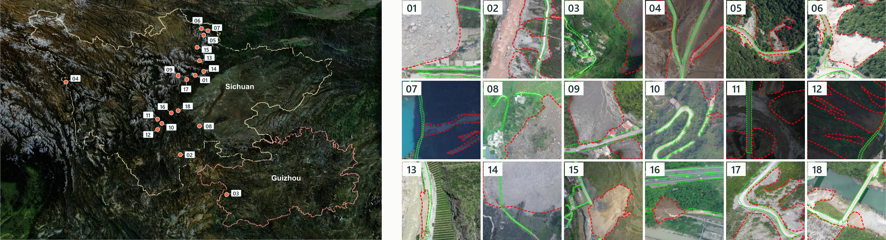

<h1 align="center">SFLData</h1>

<p align="center"><strong>UAV imagery and segmentation benchmarks for landslides and mountain roads</strong></p>



<p align="center"><em>Matching numbers connect each survey site to its UAV tile. Red outlines mark landslides and green outlines mark roads.</em></p>

<p align="center">
  <a href="#dataset">Dataset</a> &nbsp;·&nbsp;
  <a href="#environment-setup">Environment setup</a> &nbsp;·&nbsp;
  <a href="#scripts-and-entry-points">Scripts</a>
</p>

## Dataset

The **SWJTUFlashLandslide Dataset (SFLData)** pairs high-resolution UAV imagery with instance polygons that trace landslides and nearby roads in the same scene. The surveys cover roadside slopes and river valleys in Sichuan, Xizang and Guizhou in southwestern China.

The imagery comes from rapid surveys after earthquakes and heavy rainfall, as well as field inspections of historical landslides. Some flights recorded damaged or buried road sections, while others took place after access had been restored. The roads range from local unpaved roads to divided highways and interchanges.

### How instances are annotated

Annotators worked on the original-resolution images in LabelMe. They drew polygon boundaries by hand or manually corrected an initial segmentation from SAM 2. During cross-checks and joint review, they looked for missed objects, misplaced boundaries and instances that had been incorrectly merged or split.

- **Landslides.** The identifiable source, transport and depositional areas of a slide form one instance. In the source annotation, a landslide can remain a single instance even where a cleared road separates its visible parts.
- **Roads.** Polygons follow identifiable paved or unpaved roadbeds. A cleared section can be traced continuously. Where deposits completely bury the road, the annotation ends at the visible edges and disconnected visible segments form separate instances.

### Image tiles and data splits

The data are organised by survey region and split. Each JPEG tile has an image record in a COCO JSON file. For each annotated instance, the file stores its polygon, bounding box and area. The polygons can be used individually for instance segmentation or rasterised by class for semantic segmentation.

Within each region, source images were grouped by landslide instance count and assigned to training or validation before resampling and tiling. Overlapping tiles from one source image therefore stay in the same split. Tiles with no retained landslide or road polygon are kept as background examples and included in evaluation. [COCO conversion](benchmark/data/coco_convert.py) · [Tile preparation](data_pipeline/tiling/build_tiles.py)

> **Data availability** · SFLData is awaiting public release. The dataset link will appear here when access opens.

## Environment setup

Run the commands from the repository root in a Conda-enabled terminal. Choose the setup that matches your task.

<details open>
<summary><strong>Train a baseline or run checkpoint inference</strong> · GPU</summary>

The training configuration uses Python 3.11 and PyTorch 2.9.1. The following commands install the matching torchvision wheel and the shared benchmark dependencies on Linux or Windows with a CUDA 12.8-compatible NVIDIA driver.

```bash
conda create -n sfldata-train python=3.11 -y
conda activate sfldata-train
python -m pip install torch==2.9.1 torchvision==0.24.1 --index-url https://download.pytorch.org/whl/cu128
python -m pip install -r requirements.txt
python -c "import torch; print(torch.__version__, torch.version.cuda, torch.cuda.is_available())"
python tools/evaluate.py --help
```

The last value printed by the import check should be `True` for GPU training. For YOLO26l-seg, also run `python -m pip install ultralytics==8.4.19`. Other supported PyTorch builds are listed in the [official installation matrix](https://pytorch.org/get-started/previous-versions/).

</details>

<details>
<summary><strong>Prepare UAV tiles and polygon labels on CPU</strong></summary>

The standalone preparation scripts use Pillow and NumPy for images and coordinates, Shapely for polygon clipping, and SciPy for polygon smoothing.

```bash
conda create -n sfldata-tiles python=3.11 -y
conda activate sfldata-tiles
python -m pip install "Pillow>=10.0" "numpy>=1.24" "shapely>=2.0" "scipy>=1.10"
python data_pipeline/tiling/tile_labelme.py --help
```

To convert external Landslide4Sense HDF5 files, also install `h5py`. [Tile preparation](data_pipeline/tiling/build_tiles.py)

</details>

<details>
<summary><strong>Reproduce the manuscript evaluation environment</strong></summary>

The final checkpoint evaluations used a separate environment. Run the following commands to match its scoring packages.

```bash
conda create -n sfldata-eval python=3.10.19 -y
conda activate sfldata-eval
python -m pip install torch==2.7.1 torchvision==0.22.1 --index-url https://download.pytorch.org/whl/cu118
python -m pip install -r requirements.txt pycocotools==2.0.11 numpy==2.2.6 Pillow==12.0.0 scipy==1.15.3 omegaconf==2.3.0 tqdm==4.67.3
python tools/evaluate.py --help
```

For YOLO checkpoint inference, add `python -m pip install ultralytics==8.4.19`. Recalculating scores from saved predictions runs on CPU and requires the matching ground truth. For a CPU-only installation, replace `/whl/cu118` with `/whl/cpu` in the PyTorch command. [Evaluation command-line options](tools/evaluate.py)

</details>

## Scripts and entry points

| Workflow | Scripts and documentation |
|:---|:---|
| **Prepare tiles**<br>Assign source images to a split, then crop images and clip their polygons. | [Source-image splitter](data_pipeline/sampling/split_trainval.py) · [Polygon tiler](data_pipeline/tiling/tile_labelme.py) |
| **Convert annotations**<br>Export normalised YOLO polygons from tile-local LabelMe annotations and build the COCO caches used by the benchmark. | [Label exporter](data_pipeline/preprocess/labelme2yolo.py) · [COCO cache builder](tools/build_coco.py) |
| **Train a baseline**<br>Select a semantic or instance segmentation model, apply its training configuration and save checkpoints. | [Models](models/) · [Configurations](configs/models/) |
| **Evaluate predictions**<br>Score RGB class masks or COCO instances against ground truth and reproduce pooled, regional or holdout results. | [Evaluator](tools/evaluate.py) · [Ground-truth preparation](tools/build_paper_gt.py) |
